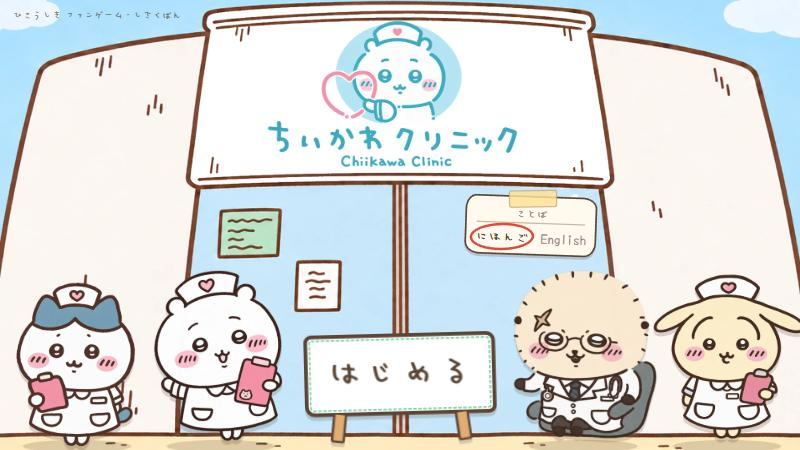
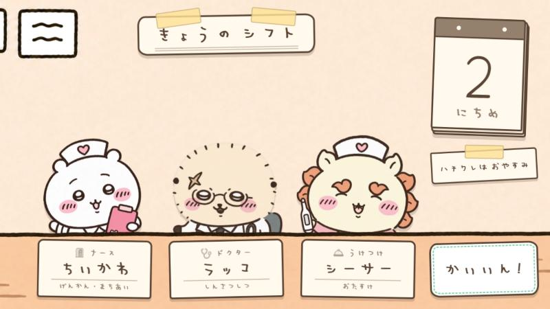
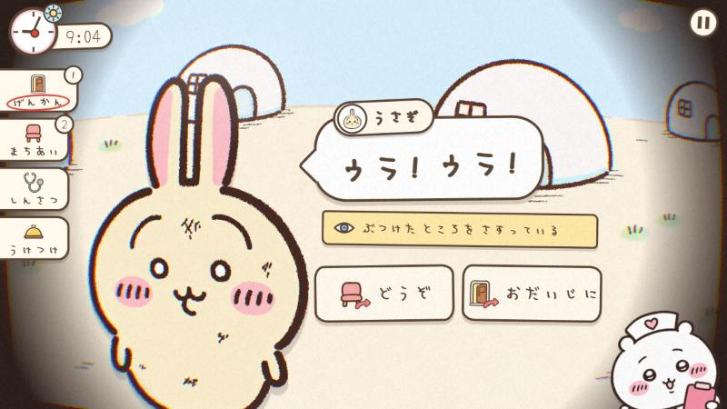
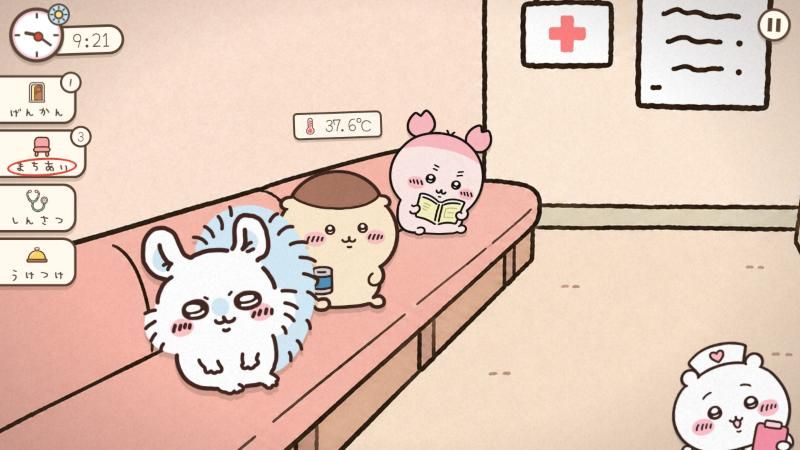
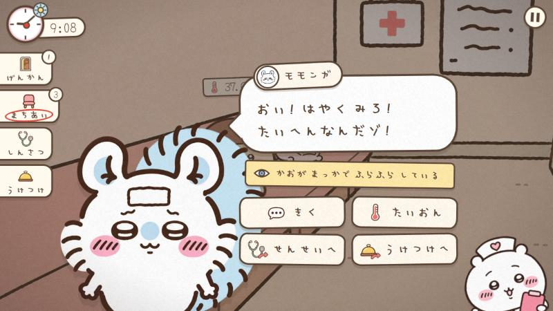
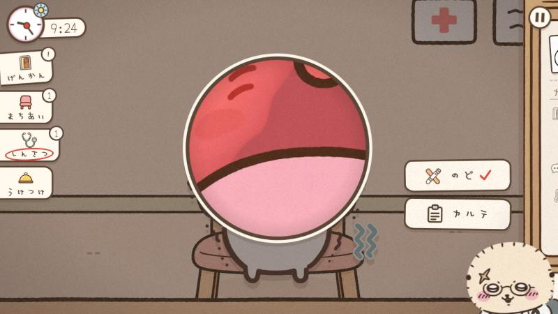
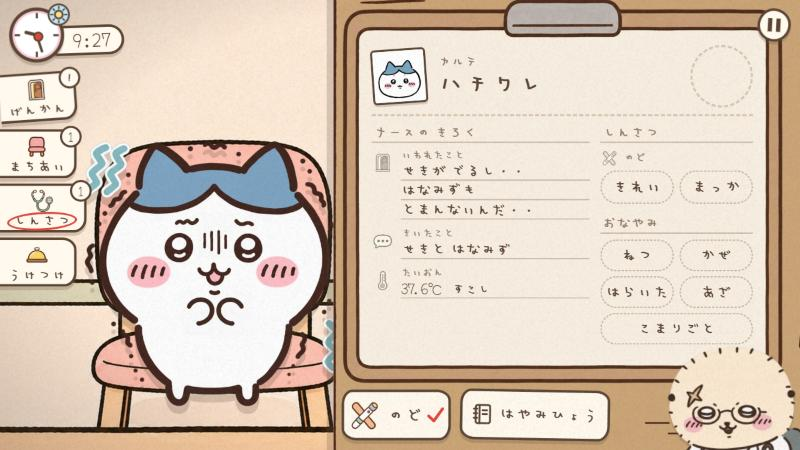
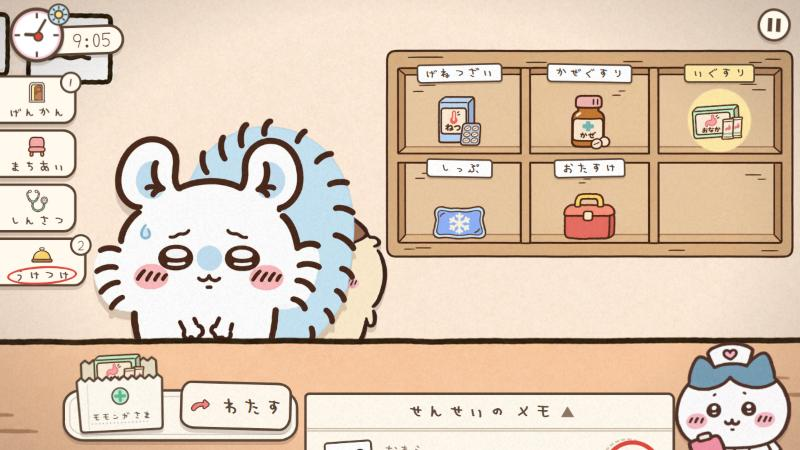
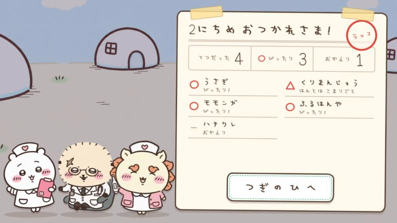

# ちいかわクリニック (Chiikawa Clinic)

A small fan game where you run a tiny clinic, one day at a time.

It is more of a help centre than a hospital. Visitors turn up with a fever, a cold, a stomach
ache, a bruise, or a small disaster of their own, such as a snapped fork or a can that will not
open. You see each of them through from the front door to the help counter, playing whoever is
on shift in each room.

**Play it here: https://phuahjinwei.github.io/Chiikawa-Clinic/**



> This is an unofficial, non-commercial fan game made for fun and for friends. It is not
> affiliated with or endorsed by the creator or publishers of ちいかわ.

## How a day goes

The clinic is open from 9:00 to 17:00, which is about three minutes of play, and at most ten
visitors come in a day. Nothing punishes being slow; you simply help fewer people.

**Morning.** The day starts with who is on shift: a nurse, the doctor and someone at the counter.
The line-up changes from day to day, and anyone who has the day off may turn up as a patient.



**The door.** You look out at whoever has knocked. Some explain what is wrong; others only make
their usual noises, so you go by how they look. Let them in, or send them home.



**The waiting room.** Patients wait on the bench. Bring one forward to ask what is wrong and take
their temperature, then send them to the doctor, or straight to the counter if no doctor is
needed.





**The doctor's room.** Look down the patient's throat by dragging the view around, then write up
the chart: circle what you saw and what you think the trouble is.





**The help counter.** Every visit ends here. Read the paper that came with the patient, pick the
right thing from the cabinet, and hand it over.



**Closing time.** At the end of the day you get the day's log: who came, and whether each of them
got what they needed.



## Playing it

- Made for phones held sideways; it also works in a desktop browser.
- Japanese by default, with English available from the title screen or the pause note.
- Pause with the button in the top-right corner. Language, sound and the camera effect are there.

## Running it yourself

You need a recent [Node.js](https://nodejs.org/) (version 22 or newer).

```sh
npm install
npm run dev
```

Then open the address it prints (usually http://localhost:5173).

To try it on a phone on the same Wi-Fi, use `npm run dev:phone` and open the network address it
prints. `npm run build` makes a version you can host as static files, in `dist/`.

## About the project

Built with [Vite](https://vite.dev/), TypeScript and [Preact](https://preactjs.com/). The
[development notes](docs/DEVELOPMENT.md) cover how the game is put together, how to replace or
add artwork, and the design decisions so far.
